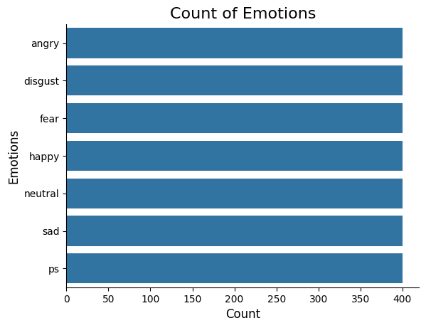
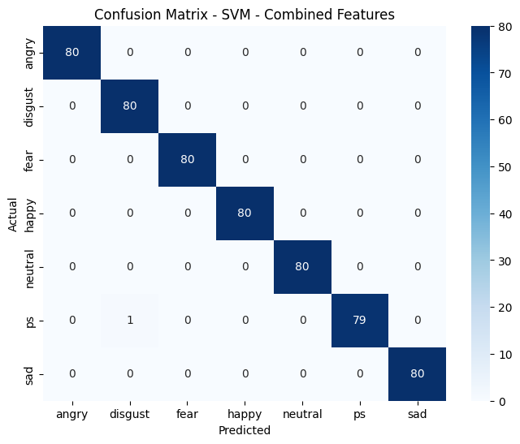
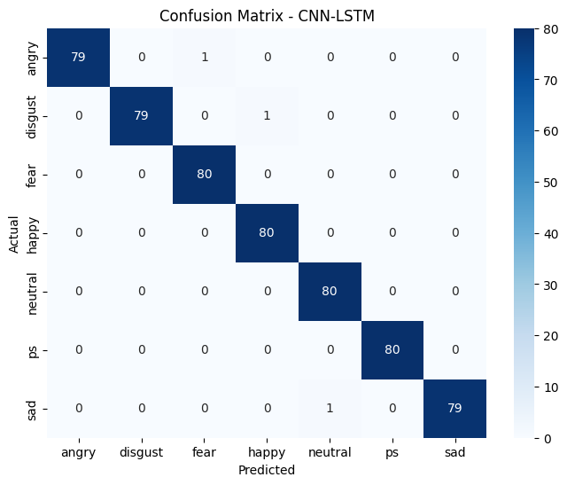
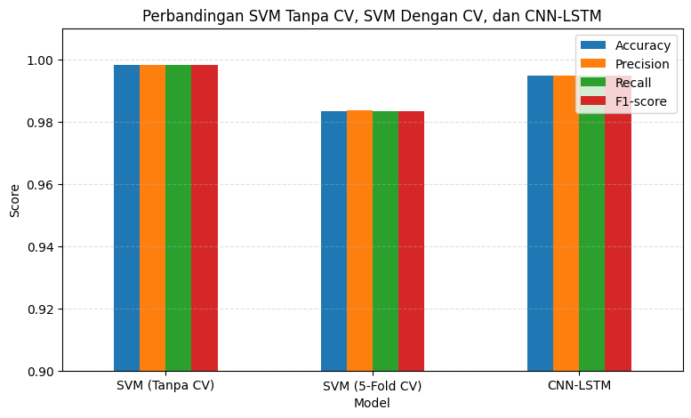
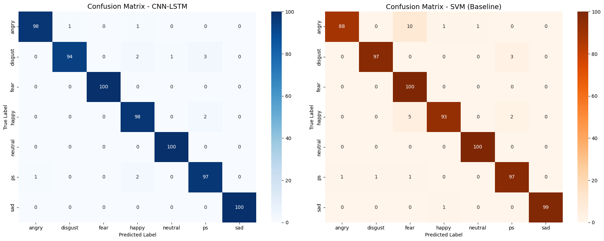
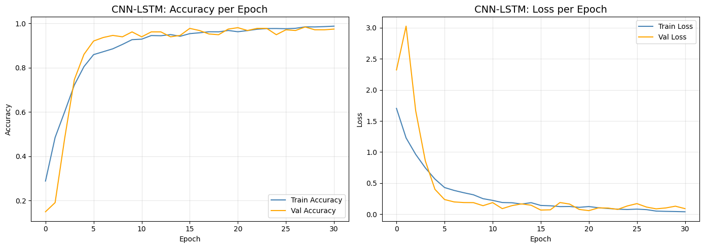
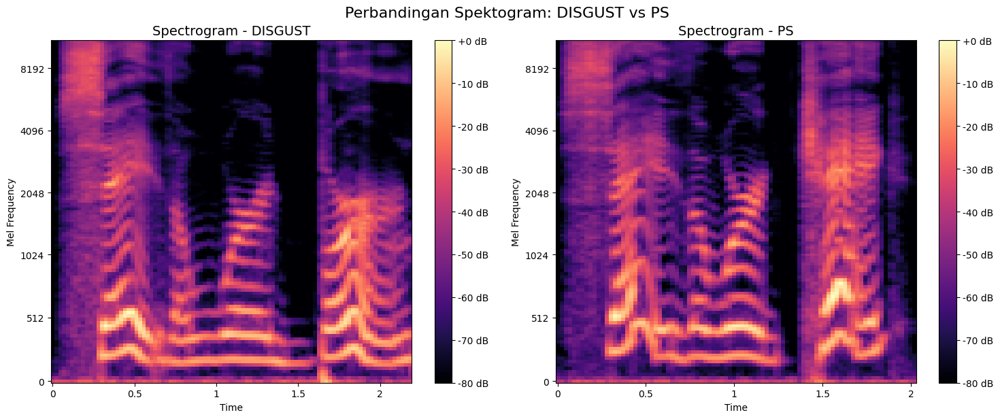
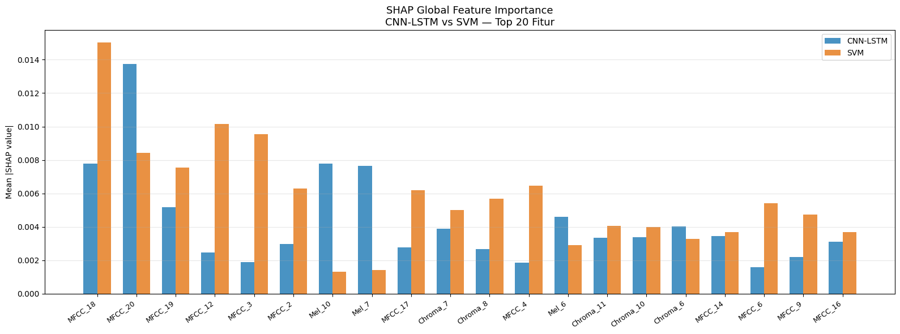

# Speech Emotion Recognition pada Dataset TESS: SVM vs CNN-LSTM dengan Explainable AI (SHAP)

Pengenalan emosi dari suara (*speech emotion recognition*) pada dataset TESS (Toronto Emotional Speech Set). Dua pendekatan dibandingkan: SVM sebagai baseline dan CNN-LSTM sebagai model utama, dengan fitur MFCC, Chroma, dan Mel Spectrogram. Interpretasi model dilakukan dengan SHAP. Proyek kelompok (Topik Khusus Kecerdasan Buatan, Departemen Teknik Informatika, Universitas Hasanuddin).

## Ringkasan Hasil

| Eksperimen | Fitur dan Model | SVM (RBF) | CNN-LSTM |
| ----- | ----- | ----- | ----- |
| 1. Tanpa augmentasi | Matriks waktu-frekuensi 128×180, split acak 80:20 (560 data uji) | 0,9982 (5-fold CV: 0,9832) | 0,9964 |
| 2. Dengan augmentasi | Vektor 160 dimensi, split per file (700 file uji) | 0,9629 | 0,9814 |

Kedua eksperimen **tidak dapat dibandingkan secara langsung** karena representasi fitur, arsitektur, hiperparameter, dan data uji berbeda. Hasil keduanya dilaporkan terpisah. Seluruh angka sangat tinggi karena keterbatasan dataset (lihat bagian Keterbatasan).

## Dataset

[TESS (Toronto Emotional Speech Set)](https://www.kaggle.com/datasets/ejlok1/toronto-emotional-speech-set-tess) berisi 2.800 file WAV dari dua pembicara perempuan (Young Adult Female dan Older Adult Female) dengan tujuh kelas emosi yang seimbang (400 file per kelas): angry, disgust, fear, happy, neutral, pleasant surprise (ps), dan sad. Setiap file berupa kalimat pendek berbahasa Inggris berdurasi sekitar 1 sampai 3 detik. Dataset tidak disertakan di repositori.



## Eksperimen 1: Tanpa Augmentasi

**Fitur.** Tiga fitur akustik digabung menjadi matriks 128 langkah waktu × 180 fitur: MFCC (40), Mel Spectrogram (128), dan Chroma (12).

**Model.**
- SVM: kernel RBF, C = 1, gamma = scale, pada fitur yang diratakan (23.040 dimensi). Dievaluasi juga dengan Stratified 5-Fold Cross-Validation.
- CNN-LSTM: dua blok Conv2D (32 dan 64 filter) dengan BatchNorm dan MaxPooling, dilanjutkan LSTM 64 unit dan Dense 64. Dilatih dengan Adam (maksimum 40 epoch, batch 16) dan EarlyStopping.

**Hasil.** Split stratified 80:20 (560 data uji).

| Model | Accuracy | F1-score |
| ----- | ----- | ----- |
| SVM | 0,9982 | 0,9982 |
| SVM (5-fold CV) | 0,9832 ± 0,0024 | 0,9832 |
| CNN-LSTM | 0,9964 | 0,9964 |

| SVM | CNN-LSTM |
| ----- | ----- |
|  |  |



## Eksperimen 2: Dengan Augmentasi dan Split per File

**Fitur.** Setiap audio dimuat 2,5 detik dengan offset 0,6 detik. Fitur dirata-ratakan terhadap waktu dan digabung menjadi vektor 160 dimensi: Chroma STFT (12), MFCC (20), dan Mel Spectrogram (128).

**Augmentasi.** Setiap file menghasilkan tiga versi: asli, dengan *Gaussian noise*, dan dengan *time stretching* ditambah *pitch shifting*.

**Pembagian data.** Data dibagi **per file asli** sebelum augmentasi dipakai: 1.785 file latih (5.355 baris, tiga versi per file), 315 file validasi, dan 700 file uji. Data validasi dan uji hanya berisi versi asli. Skala fitur (`StandardScaler`) dihitung hanya dari data latih.

**Model.**
- SVM: kernel RBF, C = 10, gamma = scale.
- CNN-LSTM: dua blok Conv1D (64 dan 128 filter) dengan BatchNorm, MaxPooling, dan Dropout 0,3, dua lapis LSTM (128 dan 64 unit), Dense 64, dan keluaran softmax 7 kelas. Adam (lr = 0,001), batch 32, EarlyStopping (patience 10) dan ReduceLROnPlateau pada validation loss. Pelatihan berhenti di epoch 31 dengan bobot terbaik dari epoch 21.

**Hasil pada 700 file uji.**

| Model | Accuracy | Precision | Recall | F1-score |
| ----- | ----- | ----- | ----- | ----- |
| SVM | 0,9629 | 0,9658 | 0,9629 | 0,9630 |
| CNN-LSTM | 0,9814 | 0,9817 | 0,9814 | 0,9814 |

CNN-LSTM lebih tinggi daripada SVM pada split ini. Karena hanya satu kali split dan selisihnya sekitar 13 file, selisih tersebut belum diuji signifikansinya.





**Analisis kesalahan.**
- SVM paling sering keliru pada *angry* yang diprediksi *fear* (10 dari 100) dan *happy* yang diprediksi *fear* (5 dari 100).
- CNN-LSTM paling sering keliru pada *disgust* yang diprediksi *ps* (3), *disgust* yang diprediksi *happy* (2), serta *happy* dan *ps* yang saling tertukar (masing-masing 2).
- Kelas *neutral*, *fear*, dan *sad* hampir selalu benar pada CNN-LSTM.
- Pola spektral *disgust* dan *ps* memang mirip (energi dan struktur harmonik yang serupa), sehingga kesalahan terkonsentrasi pada pasangan tersebut.



### Catatan metodologi: kebocoran data pada versi awal

Pada versi awal, seluruh baris (termasuk ketiga versi hasil augmentasi dari satu file) dibagi secara acak 75:25, sehingga versi augmentasi dari file yang sama dapat berada di data latih dan data uji sekaligus. Akurasi versi itu 0,9810 (SVM) dan 0,9871 (CNN-LSTM). Setelah pembagian diganti menjadi per file dan data validasi dipisahkan untuk *early stopping*, akurasi menjadi 0,9629 dan 0,9814. Hasil yang dipakai di README ini adalah versi yang sudah diperbaiki.

## Explainable AI (SHAP)

Interpretasi memakai `shap.KernelExplainer` pada 50 sampel uji dengan 100 sampel latar belakang (diringkas dengan k-means). Hasil bersifat indikatif karena jumlah sampel yang dijelaskan kecil.

- Fitur dengan kontribusi rata-rata terbesar pada CNN-LSTM adalah koefisien MFCC (terutama MFCC_20 dan MFCC_18), sedangkan pada SVM adalah MFCC_18, MFCC_12, dan MFCC_3.
- Rata-rata |SHAP| per fitur lebih besar pada MFCC daripada Chroma dan Mel pada kedua model.
- Kontribusi kelompok fitur berbeda antar emosi: pada CNN-LSTM, *neutral* dan *sad* lebih bergantung pada Chroma (sekitar 53% dan 51%), sedangkan *angry* dan *fear* lebih bergantung pada MFCC (sekitar 54% dan 59%).



## Keterbatasan

- **Variasi pembicara sangat terbatas.** TESS hanya memuat dua pembicara perempuan dengan kalimat pembawa yang sama. Pembicara dan kata yang sama muncul di data latih dan data uji, sehingga model dapat mengandalkan ciri pembicara, bukan hanya emosi. Akurasi di atas 96% sebaiknya tidak dianggap sebagai kemampuan pada data nyata.
- **Belum ada evaluasi lintas pembicara atau lintas dataset.** Satu uji kualitatif pada satu file dari dataset lain menunjukkan CNN-LSTM benar (*angry*, 99,07%) dan SVM salah (*disgust*, 53,10%). Satu contoh belum cukup sebagai bukti.
- **Perbandingan antar eksperimen tidak setara.** Eksperimen 1 dan 2 berbeda pada fitur, arsitektur, hiperparameter, dan data uji.
- **Satu kali split.** Eksperimen 2 tidak diulang dengan beberapa seed atau validasi silang per file.
- **Saran pengembangan.** Evaluasi *leave-one-speaker-out* pada dataset multi-pembicara (misalnya RAVDESS atau CREMA-D), validasi silang per file, dan arsitektur lain seperti CNN-BiLSTM atau Transformer.

## Struktur Repositori

```
├── notebooks/
│   ├── 01_experiment1_no_augmentation.ipynb
│   └── 02_experiment2_augmentation_shap.ipynb
├── assets/
└── README.md
```

## Cara Menjalankan

Notebook ditulis dan dijalankan di Google Colab dan membaca dataset dari Google Drive (`/content/drive/MyDrive/MIDTERM TK AI/DATASET`). Untuk menjalankan ulang: unduh TESS, unggah ke Drive, lalu sesuaikan `DATASET_PATH`. Library utama: librosa, scikit-learn, TensorFlow/Keras, SHAP, pandas, NumPy, Matplotlib, Seaborn.

## Tim

Proyek kelompok. 
Nama anggota:
1. Nadia Indriani Sumardi
2. Azizah Awaliyah
3. Aulia Khairunnisa Isman